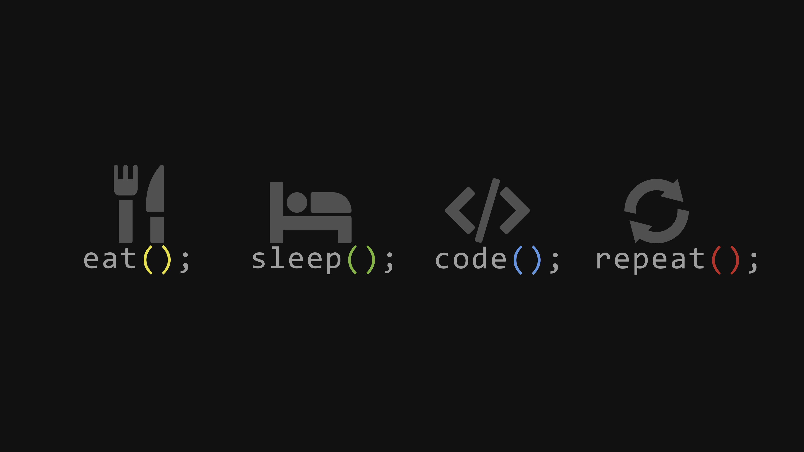

<!-- Header Image -->
<!-- 

    

  -->

<!-- 

  

 -->

  

# Hello World👋, {"I'm Mohammed Arif"};  

## 💫 About Me  
Final-year Computer Science Engineering student and Full Stack AI Developer. Passionate about building scalable applications and exploring advanced technologies.

---

## 💻 Tech Stack

  

## 🌐 My Tech Universe

  

    
 🌐 Connect with Me 

    

        
Find me on

        <!-- Gmail -->
        
        <!-- LinkedIn -->
        
        <!-- YouTube -->
        
        <!-- Instagram -->
        
        <!-- Twitch -->
        
        <!-- Discord -->
        
    

---

# 📊 GitHub Stats

  

  

  

--

## 🐍 GitHub Contribution Graph
<!--## 🐍 GitHub Contribution Snake  -->

  <picture>
    <source media="(prefers-color-scheme: dark)" srcset="https://raw.githubusercontent.com/Arifcodes11/Arifcodes11/output/github-snake-dark.svg" />
    
  </picture>

---

<!--## 👀 Profile Visits  

  

-->
