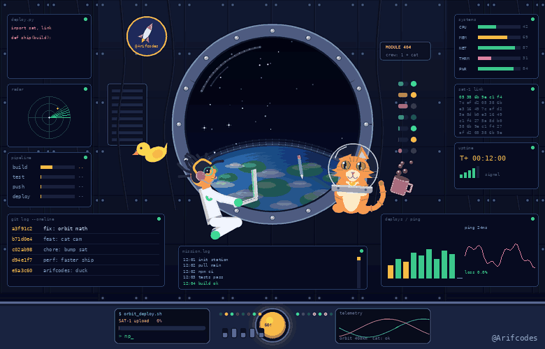

  
 
  
 
  
 

Final-year Computer Science Engineering student and Full Stack AI Developer. Passionate about building scalable applications and exploring advanced technologies.

 
  
 
  
  
   
 
  
 
  
  
  
 
